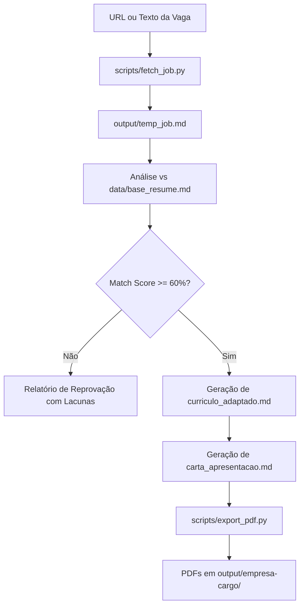

# Job Matcher & Resume Tailor

Skill inteligente e ferramenta de automação para o **Google Antigravity**, projetada para realizar a triagem técnica de vagas de emprego, calcular a taxa de aderência (*Match Score*) contra um currículo mestre e gerar materiais de candidatura personalizados e de alto impacto (currículo adaptado e carta de apresentação), com exportação para PDF.

---

## 📁 Estrutura do Projeto

```text
job-matcher-tailor/
├── SKILL.md                  # Instruções de ativação, regras de negócio e rubrica de avaliação da IA
├── README.md                 # Documentação detalhada da skill e guia de uso
├── requirements.txt          # Dependências Python (httpx, trafilatura, bs4, markdown, weasyprint)
├── data/
│   ├── base_resume.md        # Currículo completo e estruturado do candidato (fonte única da verdade)
│   └── cover_template.md     # Template padrão parametrizado para carta de apresentação
└── scripts/
    ├── fetch_job.py          # Extrai e limpa a descrição textual de vagas via URL ou HTML local
    └── export_pdf.py         # Converte os arquivos Markdown gerados em PDFs estilizados (A4 / ATS-friendly)
```

---

## ⚙️ Pré-requisitos e Configuração do Ambiente

Recomenda-se utilizar um ambiente virtual (`.venv`) isolado com Python 3.10+:

```bash
# 1. Criação do ambiente virtual
python3 -m venv .venv

# 2. Ativação do ambiente
source .venv/bin/activate

# 3. Instalação das dependências
pip install -r .agent/skills/job_matcher_taylor/requirements.txt
```

> **Nota:** Para o funcionamento pleno do `weasyprint` no Linux, são necessárias as bibliotecas gráficas padrão do sistema (como `libpango`, `libharfbuzz` e `fontconfig`).

---

## 🚀 Fluxo de Operação

O fluxo é acionado automaticamente pelo assistente ao fornecer uma URL ou texto de vaga:



### 1. Extração dos Dados da Vaga
A partir da URL ou arquivo fornecido, o script extrai requisitos, responsabilidades e desafios técnicos:
```bash
python .agent/skills/job_matcher_taylor/scripts/fetch_job.py --url "<URL_DA_VAGA>" --output "output/temp_job.md"
```

### 2. Avaliação e Rubrica de Pontuação (*Match Score*)
A IA confronta as exigências da vaga contra o `data/base_resume.md` utilizando a seguinte matriz:

| Pilar de Avaliação | Peso | Critério de Pontuação |
|---|:---:|---|
| **Requisitos Obrigatórios / Hard Skills** | **40%** | Proporção de linguagens, frameworks, bancos e ferramentas indispensáveis dominados. |
| **Tempo e Nível de Experiência** | **25%** | Compatibilidade de senioridade e anos de atuação prática comprovada. |
| **Requisitos Desejáveis / Diferenciais** | **20%** | Conhecimentos secundários, certificações, arquiteturas específicas ou domínio de negócio. |
| **Alinhamento do Papel e Escopo** | **15%** | Correspondência entre as responsabilidades do dia a dia e o histórico de entregas. |

$$\text{Score Total} = (S_{\text{obrig}} \times 0.40) + (S_{\text{exp}} \times 0.25) + (S_{\text{desej}} \times 0.20) + (S_{\text{escopo}} \times 0.15)$$

### 3. Decisão por Limiar (Threshold de 60%)
- **Score < 60%:** A candidatura é considerada inviável. A IA gera um relatório detalhado justificando as lacunas técnicas impeditivas.
- **Score ≥ 60%:** Aprovado para customização imediata de materiais.

### 4. Customização do Currículo (`curriculo_adaptado.md`)
* **Inviolabilidade Factual:** É proibido inventar empresas, cargos, métricas ou competências ausentes do `base_resume.md`.
* **Alinhamento ATS:** Terminologias técnicas são ajustadas para espelhar as palavras-chave do anúncio da vaga.
* **Reordenação Estratégica:** Realizações e stacks de maior impacto para a vaga são movidas para o topo.
* **Filtragem de Ruído:** Tópicos secundários irrelevantes são resumidos ou omitidos.

### 5. Carta de Apresentação (`carta_apresentacao.md`)
Preenchimento automático do template `data/cover_template.md` conectando:
* Dores operacionais críticas da empresa contratante.
* Realizações concretas do candidato acompanhadas de métricas comprovadas.
* Diferenciais metodológicos (SRE, governança, IA, automação).

### 6. Exportação para PDF (`export_pdf.py`)
Converte os arquivos Markdown gerados em PDFs elegantes e otimizados para ATS:
```bash
python .agent/skills/job_matcher_taylor/scripts/export_pdf.py "output/<empresa>-<cargo>/"
```

---

## 🛠️ Detalhes dos Scripts Auxiliares

### `scripts/fetch_job.py`
Extrai o conteúdo textual de vagas contornando cabeçalhos e páginas de autenticação via `trafilatura`, `httpx` e `BeautifulSoup`.
```bash
# Via URL pública
python scripts/fetch_job.py --url "https://site.com/vaga" --output "output/temp_job.md"

# Via arquivo HTML salvo localmente
python scripts/fetch_job.py --file "caminho/pagina.html" --output "output/temp_job.md"

# Saída estruturada em JSON
python scripts/fetch_job.py --url "https://site.com/vaga" --json
```

### `scripts/export_pdf.py`
Converte arquivos Markdown para PDF aplicando CSS Paged Media com paginação A4, tipografia limpa e renderização ATS-friendly.
```bash
# Processar todos os markdowns de um diretório
python scripts/export_pdf.py "output/<empresa>-<cargo>/"

# Processar um arquivo Markdown específico
python scripts/export_pdf.py "output/<empresa>-<cargo>/curriculo_adaptado.md" --output "meu_curriculo.pdf"

# Utilizar um CSS customizado
python scripts/export_pdf.py "caminho/arquivo.md" --css "meu_estilo.css"
```

---

## 📂 Saídas Geradas

Cada análise aprovada gera uma pasta dedicada em `output/<empresa>-<cargo>/`:
* `curriculo_adaptado.md` & `curriculo_adaptado.pdf`
* `carta_apresentacao.md` & `carta_apresentacao.pdf`